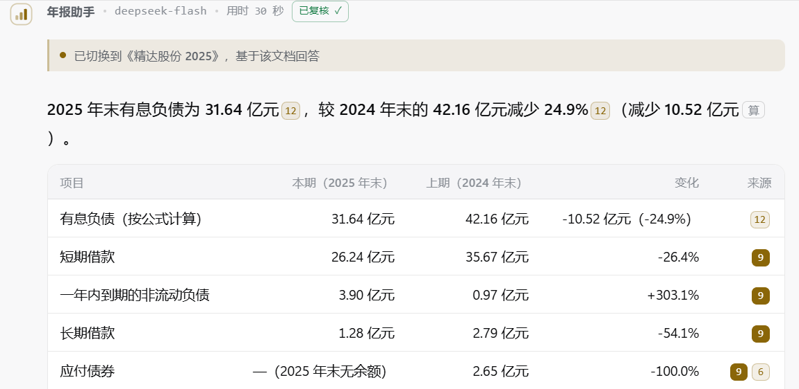
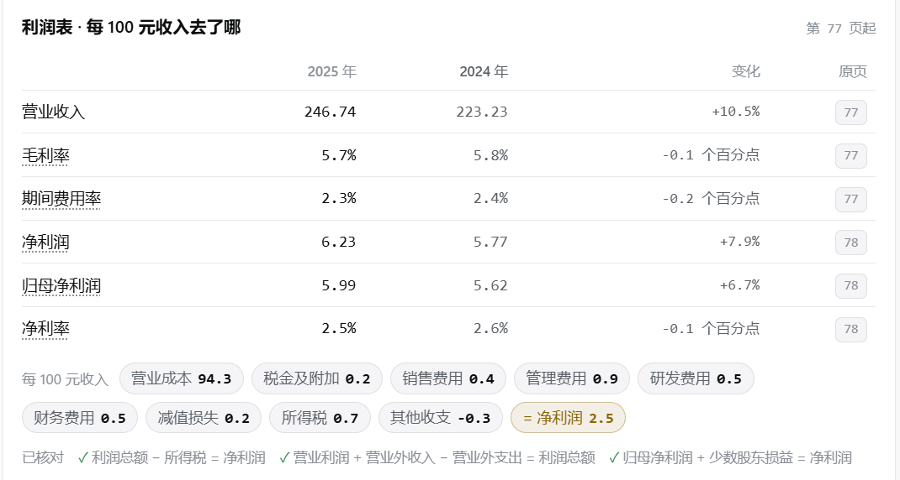
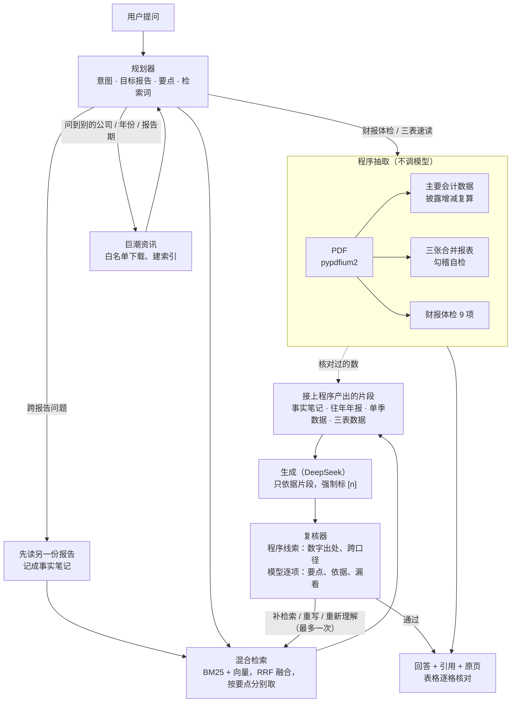

# 年报 AI 研究助手

读 A 股定期报告（年报、一季报、半年报、三季报）的 AI 助手，面向散户。**每个数字都能点回原页核对**：
回答带引用编号，点开看原文片段、翻到 PDF 那一页；表格里的数字逐格核对出处；关键财务数字由程序从报表里抽取并做勾稽自检，不交给大模型编。

**[在线使用](https://xlyzp-ai.streamlit.app/)** · **[评测结果](https://xlyzp-ai.streamlit.app/?eval=1)** · **[产品文档](docs/PRODUCT.md)** · **[源码](https://github.com/lovwellcomm-cell/-ai-)**



## 亮点

### 1. 每个数都能核对

- 回答里每个论断标 `[n]`，点开是原文片段，再点一下渲染 PDF 原页。
- 回答里的 Markdown 表格由程序**逐格核对**（`rag/fidelity.py`）：每个数字都要在引用片段里找到出处，或能由片段数字算出；找不到的在界面上用虚线标出来。
- 交给用户之前，**复核器**再查一遍：每个要点答到没有、说法有没有依据、片段里明明有却说「未找到」。不过关就补检索、重写或重新理解问题，最多回退一次。
  复核器评测：8 个正常回答全部放行，往正常回答里注入的 33 处错误（改数字、编原因、错年份、答非所问、跨口径计算）全部拦下。

### 2. 关键数字交给程序，不交给模型

- 主要会计数据、三张合并报表、财报体检 9 项都是**确定性抽取**，不调大模型，每个数带原文页码。
- 三张表抽完先做**勾稽自检**：资产 = 负债 + 所有者权益、现金流入 − 流出 = 净额、期初 + 净增加 = 期末、利润总额 − 所得税 = 净利润……
  **对不上的表不展示**。本机 21 份报告（含季报、半年报）63/63 张表通过；和「主要会计数据」表交叉核对 98/98。
- 核对过的三张表也会作为片段喂给回答：问「有息负债」「自由现金流」时，模型直接引用核对过的数，按公式算出的指标会注明「按公式计算」。
  对照实验：同样 7 道题，接这些片段 7/7 答对，不接只有 5/7。



### 3. 懂财务口径和时间

- 「最新财报」「目前负债率」落到**已披露的最近一期**；报告期还没结束的报告直接说明最晚何时披露，不去瞎找。
- 季报是年初至今的累计数：九个月不能和十二个月算增长率，不同年份的累计数不能相减。回答里出现这种**跨口径计算**，程序查出来直接判重写（`rag/caliber.py`）。
- 问「和最新季报比」这类跨报告问题，会先读另一份报告、把核对过的数记成笔记，再在主报告上回答，每个数写明出自哪份报告。

## 能做什么

| 功能 | 说明 | 调用模型 |
|---|---|---|
| 问答 | 任意问题，回答带引用和原页；问别的公司、别的年份时自动从巨潮资讯找报告、下载建索引 | 是 |
| 财报体检 | 审计意见、利润和现金流含金量、客户集中度、商誉、大股东质押等 9 项，红黄绿灯，判断标准公开 | 否 |
| 三表速读 | 资产负债表（家底）、利润表（每 100 元收入去了哪）、现金流量表（钱的来去），勾稽对上才出 | 否 |
| 几件大事 | 从年报里找出最能左右业绩的外部因素，配官方行情（期货交易所、外汇交易中心中间价、LPR）和影响估算 | 找因素用模型，数字程序核对 |
| 多年趋势 / 单季 | 自动补往年年报拉长到 6 年；用几份报告的累计数相减拼出最近 8 个季度 | 否 |
| 行业动态 | 联网查原材料价格、竞争格局、同行进展，单独成块、标「未经报告核验」 | 是 |

不做：荐股、预测股价、实时行情。原因见[产品文档](docs/PRODUCT.md)。

## 架构



| 模块 | 做什么 |
|---|---|
| `rag/planner.py` | 规划器：一次调用拿到意图、目标报告、要点和检索词；失败时退回规则 |
| `rag/retriever.py` | BM25 + bge-small-zh 向量（ONNX，CPU），RRF 融合；一问多项时按要点分别检索 |
| `rag/generator.py` | 生成：只依据片段，数字附原值，答不出就说「未找到」 |
| `rag/reviewer.py` | 复核器：程序线索 + 模型逐项判断，`decide()` 决定怎么回退（纯函数，有测试） |
| `rag/fidelity.py` / `rag/caliber.py` | 数字出处核对 / 跨口径计算检查 |
| `rag/notes.py` | 事实笔记：前几轮核对过的数字带进下一轮，跨报告回答靠它 |
| `rag/financials.py` / `rag/statements.py` / `rag/healthcheck.py` | 主要会计数据 / 三张合并报表 / 财报体检，全部程序抽取 |
| `rag/periods.py` | 四种报告期、「最新」落到哪一期、披露截止日 |
| `ui/turn.py` | 回合状态机（理解 → 检索 → 生成 → 复核 → 回退 / 收尾），纯函数，可单测 |
| `web/` | 聊天界面和开屏页（Streamlit 自定义组件，原生 JS） |

## 怎么知道它靠谱

每个功能上线前都跑评测，改动和对照组一起跑。题目是作者自建的，覆盖精达股份、时代新材、贵州茅台、七匹狼等约 15 家公司的报告；用真实模型跑，结果会有波动，下面是 2026-11-03 的结果。
**[评测页](https://xlyzp-ai.streamlit.app/?eval=1)** 上有每次上线的记录、复核器真实拦下的错误、对照实验和改进历程。

| 评测 | 测什么 | 结果 |
|---|---|---|
| `tools/eval_e2e` | 端到端：用对报告、关键数字都在、不误答「未找到」、跨报告引用了笔记 | 37 题全部合格 |
| `tools/eval_intent` | 规划器理解问题：意图、目标报告、要不要出卡片、先读哪份报告 | 60 题 59 题全对 |
| `tools/eval_review` | 复核器：正常回答放行、注入的错误拦下 | 放行 8/8，拦下 33/33 |
| `tools/eval_statements` | 三张表：勾稽自检出表率、交叉核对、人工核过的难点行 | 63/63 · 98/98 · 20/20 |
| `tools/eval_healthcheck` | 体检抽取，对照人工核过的答案 | 96/96（15 份报告） |
| `tools/eval_drivers` | 几件大事：关键因素命中 | 19/19（13 份报告） |
| `python -m pytest` | 单元测试（夹具多是真实报告原文行） | 773 个 |

评测脚本都在 `tools/`，结果写到 `eval_out/`（不入库）。改了回答流程的上线，合并前跑 `python -m tools.release_eval`，结果追加到 [`docs/eval/history.jsonl`](docs/eval/history.jsonl)，评测页的数据 `docs/eval/snapshot.json` 同时重新生成。

## 技术栈

Python 3.12+ · Streamlit 1.66（自定义组件） · pypdfium2 · onnxruntime + bge-small-zh-v1.5 · rank-bm25 + jieba · DeepSeek（OpenAI 兼容接口，含 Search / Fetch 工具调用）

没有用 PyMuPDF 和 PyTorch：部分 Windows 环境的应用控制策略会拦截它们的原生库。

## 本地运行

```bash
pip install -r requirements.txt
cp .env.example .env      # 填入 DEEPSEEK_API_KEY
python -m streamlit run app.py
```

国内网络下载向量模型慢时，在 `.env` 里加 `HF_ENDPOINT=https://hf-mirror.com`。首次提问前会下载约 95 MB 的模型。

```bash
pip install -r requirements-dev.txt
python -m pytest -q                       # 单元测试，不需要模型
python -m tools.eval_statements           # 三表抽取评测，不需要模型
python -m tools.eval_e2e --engines plain --workers 3 --tag x   # 端到端评测，需要 Key 和本地报告
```

## 部署到 Streamlit Community Cloud

1. 仓库推到 GitHub，在 share.streamlit.io 新建应用：分支 `main`，入口 `app.py`，Python 3.12 或 3.13。
2. Secrets 填 `DEEPSEEK_API_KEY = "sk-..."` 和 `PUBLIC_DEMO = "1"`。

公开演示模式下的保护：

| 保护 | 默认值 |
|---|---|
| 每个会话的免费提问 / 全站每天 | 5 次 / 100 次（访客可填自己的 Key，不计额度） |
| 每个会话导入报告 | 2 份（上传或自动从巨潮导入） |
| 上传 | 40 MB、400 页；访客之间隔离，24 小时后清理 |
| 下载 | 只认巨潮资讯（`www.cninfo.com.cn` / `static.cninfo.com.cn`）的 https 地址，拒绝内网地址 |

这些是软限制，真正的损失上限是 DeepSeek 账户的预充值余额。

**确认线上跑的是哪一版**：打开 `https://<你的应用>/?build=1`，侧边栏显示源码指纹；本地运行
`python -c "from rag.freshness import source_stamp; print(source_stamp())"`，两边一致即可。
Cloud 原地更新时不一定重启进程，`rag/freshness.py` 发现磁盘上的源码变了会自动重新导入。

## 开发说明

完整的开发说明（代码怎么生效、部署自检、组件的坑、评测命令）见 [docs/DEVELOPMENT.md](docs/DEVELOPMENT.md)。要点：

- **界面**：左侧文档栏是原生 Streamlit 控件（上传必须留在这里）；主区对话面板是 `st.components.v2` 自定义组件，由 `web/chat.*` 渲染，`ui/payload.py` 把会话状态整形成组件要的数据。改 `web/` 下的文件刷新浏览器即可。
- **安全**：组件里的 HTML 不消毒，而数据里有用户提问和模型输出，所以 `web/chat.js` 里动态文本一律用 `textContent`；浏览器存档送回的对话由 `ui/memory.py` 按白名单校验。
- **预览**：`python tools/build_preview.py` 生成 `design/preview.html`，不起后端、不花 API 额度就能看完整界面；开屏页预览 `python -m tools.build_landing_preview`。

## 已知限制

- 只支持文字版 PDF，不支持扫描件（没有 OCR）。
- 银行、证券、保险公司的报表结构不同，三表速读暂不支持。
- 一次只回答一家公司的问题，同行对比还没做。
- 评测题目是作者自建的，覆盖的公司有限；复核器和逐格核对查的是「有没有出处」，报告本身写错了查不出来。
- 联网内容（行业动态、年报答不出时的补充）未经报告核验，单独成块并标明。
- 免费托管的服务器在美国，国内访问速度取决于网络；闲置后休眠，再次打开要几十秒唤醒。

## 许可

代码使用 MIT 许可证，见 [LICENSE](LICENSE)。`demo/` 中的示例年报来自上市公司公开披露的文件，版权归原公司所有，仅用于演示。
